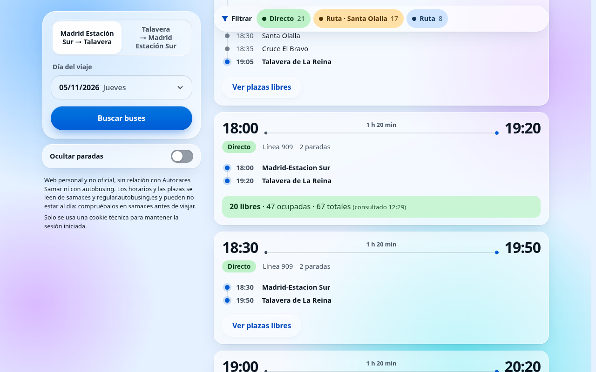
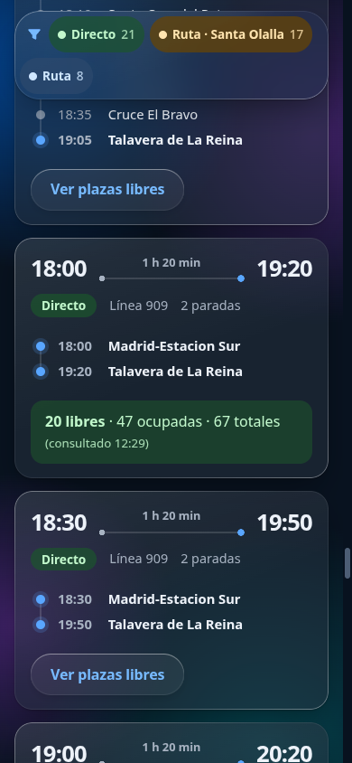
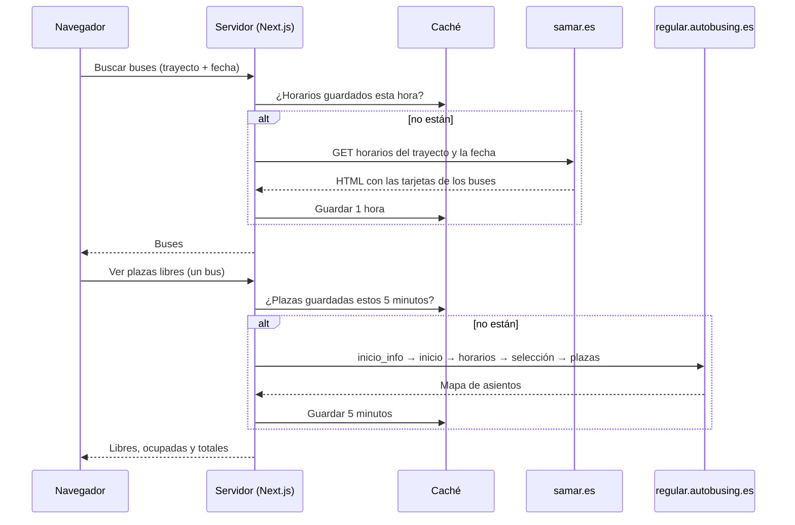

# Buses Madrid ↔ Talavera

Web para consultar de un vistazo los buses de Samar entre **Madrid Estación Sur** y **Talavera de la Reina**: tipo de bus, paradas, avisos y plazas libres.


<table>
  <tr>
    <td width="68%"></td>
    <td width="32%"></td>
  </tr>
</table>

> Proyecto personal y **no oficial**, sin relación con Autocares Samar ni con autobusing. No hay demo pública: la web que yo uso está protegida con contraseña.

## Por qué

Voy a menudo de Madrid a Talavera y al revés. Antes de ir a la estación quiero saber qué buses salen ese día y cuál me conviene, y la web oficial no lo enseña de un vistazo:

- **Directo o de ruta.** Quiero ver cuántas paradas hace cada bus y a qué hora pasa por cada una.
- **Santa Olalla.** Que el bus pare allí decide si me sirve el abono.
- **Plazas.** Solo se ven entrando en el proceso de compra, bus a bus.

Además, los horarios tienen que ser los **de ese día**. La fuente oficial en datos abiertos (el GTFS del NAP) está caducada y no recoge los cambios de última hora, así que la web lee lo mismo que ve quien entra en samar.es.

## Qué hace

- Dos trayectos (Madrid Estación Sur → Talavera y al revés) y un calendario propio con los próximos 60 días.
- Cada bus con salida, llegada, duración, línea, número de paradas e itinerario completo con la hora de cada una.
- Tipo de bus: **Directo** (2 paradas), **Ruta · Santa Olalla** o **Ruta** (de ruta sin parar en Santa Olalla). Se pueden filtrar, y el filtro cuenta cuántos hay de cada tipo.
- Los avisos de Samar, tanto los generales como los de parada («solo llega hasta Alcorcón»).
- **Ver plazas libres**, bus a bus y solo cuando se pulsa.
- **Comprar en autobusing** desde cada bus: abre la venta oficial con el trayecto y la fecha, y dice qué fila de su tabla elegir. El pago y los datos del viajero se quedan en autobusing.
- Interruptor **Ocultar paradas** para una lista compacta. Las preferencias se recuerdan en el navegador.
- Entrada con una contraseña compartida y oculta a los buscadores (`noindex`).

## Cómo funciona

No hay base de datos, ni tareas programadas, ni nada que consulte Samar por su cuenta. Solo se pide algo a Samar cuando alguien pulsa un botón, y casi siempre se responde desde la caché.



### Horarios (samar.es)

Una sola petición `GET` por trayecto y fecha a la página pública de resultados de samar.es, que se genera en el servidor y trae el itinerario completo de cada bus. Su `robots.txt` permite `/horarios/`. No se usa su API interna, que `robots.txt` excluye.

- El resultado se guarda **1 hora**. La clave de caché incluye la franja horaria (para no servir nunca datos más viejos que eso) y la versión del formato de los datos (para no servir datos con una forma antigua tras un despliegue).
- Si samar.es cambia su HTML, la búsqueda **da error**. El contador «N resultados» de la página tiene que coincidir con el número de tarjetas leídas, así que no se muestran datos a medias.

### Plazas (autobusing)

Las plazas solo existen en el motor de venta, así que se recorre su flujo con una sesión: `inicio_info` → `inicio` → `horarios` → selección → `plazas`. Son 5 peticiones por bus, por eso solo se hacen **bajo demanda** y se guardan **5 minutos**.

- **Nunca pasa del paso «Plazas».** No rellena datos ni compra nada.
- Los códigos de parada y las horas salen siempre de los horarios de samar.es que ya están en caché, **nunca del cliente**.
- autobusing no da ni línea ni número de expedición, así que el bus se empareja **por hora de salida y de llegada**, o por descarte entre los que salen a la misma hora. La web comprueba además que la página de plazas es de la fecha y la hora pedidas.
- **Alcorcón.** Algunos buses de Talavera a Madrid solo llegan hasta Alcorcón. Las dos webs lo dicen (samar.es en un aviso, autobusing en una nota de la fila), y un bus solo se empareja con filas que tengan su misma marca. Así el 05:45 normal y el 05:45 de Alcorcón no se mezclan, aunque en autobusing los dos digan 05:45 → 07:05. Si ninguna fila del día lleva la nota, la web no se fía y dice «No se distingue el bus de Alcorcón en autobusing» (quizá autobusing cambió su página).
- **Dos buses con las mismas horas** en samar.es (el 909 de ruta y el 910 de las 07:00 entre semana): no se dan plazas, porque no se sabe cuál es cuál («Otro bus de Samar tiene las mismas horas»). Pero se mira autobusing: si a esa hora no hay ninguna fila, dice «No aparece en la venta online».
- autobusing da llegadas teóricas (los directos, siempre salida + 1 h 20) y **esconde los autobuses llenos**. Por eso, si no hay fila, la tarjeta dice «No aparece en la venta online», que puede ser que esté completo.
- Ante la duda, dice **«Plazas no disponibles»** con el motivo, antes que enseñar el dato de otro bus.
- Distingue entre plazas con cifra, «Completo» y «Quedan plazas» (buses sin elección de asiento que no están completos).
- **Refuerzos.** Si un horario lleva varios autobuses (varias filas idénticas en autobusing), enseña las plazas de cada uno por separado. Cada fila se consulta con su propia sesión, porque la página de plazas no dice qué fila se eligió.
- **Refuerzos por descarte.** Si a una hora sobran filas que no coinciden con ningún bus de samar.es y solo queda un bus sin pareja, se le asignan todas (hasta 3), aunque lleguen a otras horas (05:15 → 07:05 en samar.es, 07:10 y 07:15 en autobusing). La tarjeta dice la llegada de cada uno y avisa de que puede que no hagan el mismo recorrido.
- **Regla del 909 directo** (experimental). autobusing pone a los 909 directos la llegada salida + 1:20, así que esa fila es del 909 y las demás de esa hora no. Con ella:
  - el 909 y el 905 de las 09:00 de los sábados, que en samar.es llegan los dos a las 10:20, ya no son «no disponible»: el 909 recibe la fila 10:20 y el 905 la 10:50;
  - las filas que sobran a una hora (07:15 y 12:25 de los sábados) van al único bus de esa hora que no es 909 directo, como un autobús más de su refuerzo.

  Para quitarla, `DIRECT_909_RULE = false` en `lib/rules.ts`: todo vuelve a funcionar como antes (hay un test que lo comprueba en todos los fixtures).

### Comprar

El enlace abre el paso 1 de autobusing con el trayecto y la fecha, pero **sin la hora**. Con la hora, como hace samar.es, autobusing elige él el bus de esa hora y salta a las plazas, aunque a esa hora salgan varios. Sin ella, tras el paso 1 enseña su tabla Horarios y quien compra elige la fila exacta (salida y llegada) que le indica la tarjeta. Este enlace no hace ninguna petición desde el servidor.

Los buses con precio 0,00 en samar.es (la línea 907, que se paga en el bus) no se venden online: su tarjeta lo dice y no tiene ni «Ver plazas libres» ni «Comprar».

### Cuántas peticiones salen

| Acción | Peticiones a terceros | Se repite como mucho |
| --- | --- | --- |
| Buscar buses | 1 | cada hora por trayecto y fecha |
| Ver plazas libres | 5 | cada 5 minutos por bus |

Cada petición tiene un tiempo máximo de 10 s (30 s por ruta de API), y el navegador cancela la búsqueda anterior si lanzas otra.

## Estética

Estilo «cristal líquido» (iOS/macOS) con animaciones de muelle en CSS puro (`linear()`), sin librerías de interfaz ni de animación. Todos los colores y la materia del cristal viven en `app/theme.css`: cambiando los cuatro `--hue-*` se recolorea toda la web (hay paletas de ejemplo en el comentario de cabecera). Respeta el modo oscuro, `prefers-reduced-motion`, `prefers-reduced-transparency` y `prefers-contrast`.

## Ajustes

- **Plazas de las líneas 901–905.** Estas líneas siguen hacia Extremadura y se muestran con un aviso de que las plazas podrían ser de todo el recorrido. Para fiarte de que son las de tu tramo, vacía `PASS_THROUGH_LINES` en `lib/rules.ts`.
- **Duración de la caché:** `TRIPS_TTL_S` y `SEATS_TTL_S` en `lib/cache.ts`.
- **Días hacia delante:** `MAX_DAYS_AHEAD` en `lib/rules.ts` (60).

## Limitaciones conocidas

- La web lee el HTML de samar.es y de autobusing. Si cambian su diseño, la búsqueda dará error («No se pudo consultar Samar») y no mostrará datos a medias.
- Las plazas se buscan en autobusing por hora de salida y llegada.
  - Si solo coincide la salida, y no hay otro bus de Samar a esa hora, se muestran con un aviso.
  - Si autobusing marca el bus como «Completo», se indica que no quedan plazas.
  - Algunos buses, sobre todo de ruta, no tienen elección de asiento en la venta online. Autobusing no da su número de plazas, ni siquiera en la pantalla de datos del viajero. Si no están marcados como «Completo», la web indica «Quedan plazas» sin cifra.
- Algunas 909 continúan hasta el aeropuerto. Sus plazas se muestran sin aviso.
- Solo un trayecto: Madrid Estación Sur ↔ Talavera. No hay otras estaciones ni buses que solo aparezcan en autobusing.
- La interfaz se prueba automáticamente en navegadores y tamaños de pantalla simulados (ver [Tests](#tests)). No se ha probado en dispositivos físicos ni en plegables reales, y WebKit se parece a Safari pero no es Safari.

## Desarrollo

```bash
npm install
echo 'APP_PASSWORD=una-contraseña' > .env.local
npm run dev        # http://localhost:3000
npm test           # tests de lib/ con respuestas guardadas; no consultan Samar
npm run test:e2e   # tests de la interfaz en el navegador (ver «Tests»)
npm run typecheck
npm run lint
```

Requiere Node 22.18 o superior, porque los tests usan `node --test` con TypeScript directamente. Los tests trabajan con HTML real guardado en `tests/fixtures/` y nunca consultan las webs.

## Tests

| Qué | Comando | Qué cubre |
|---|---|---|
| Lógica (`tests/*.test.ts`) | `npm test` | Lectura de samar.es y autobusing, reglas, calendario, sesión y reglas del proxy. Tarda un instante. |
| Interfaz (`tests/e2e/`) | `npm run test:e2e` | Búsqueda, errores, tarjetas y plazas, filtros, calendario, login, accesibilidad (axe) y maquetación en móviles, tabletas y plegables, en vertical y en horizontal. |

Los tests de interfaz usan Playwright con la web real compilada (`next build` + `next start`, en el puerto 3100) y **no consultan Samar ni autobusing**: las respuestas de `/api/trips` y `/api/seats` se sustituyen por datos construidos con el lector real sobre el HTML guardado en `tests/fixtures/`. El reloj se fija en el 3/11/2026.

- **En local** todo corre en Chromium; por defecto en Brave (`/usr/bin/brave-origin`). Cambia el ejecutable con `PW_BROWSER=/ruta/al/navegador`, o con `PW_BROWSER=` (vacío) para usar el Chromium de Playwright tras `npx playwright install chromium`. Los dispositivos se simulan con su tamaño, densidad y pantalla táctil: sirve para la maquetación, pero no detecta fallos propios de Safari o Firefox.
- **En GitHub Actions** (`.github/workflows/test.yml`) hay dos niveles:
  - **En cada subida a `main` y en cada pull request:** `lint`, `typecheck` y `npm test`, más una selección corta de la interfaz con motores reales: escritorio en Chromium, Firefox y WebKit, y además iPhone SE en horizontal (WebKit), iPad Mini en vertical (WebKit) y Galaxy Z Fold 6 abierto en vertical (Chromium).
  - **Matriz completa**, solo a mano: *Actions → Tests → Run workflow*. Cada dispositivo usa su motor real: **WebKit** para iPhone y iPad (y escritorio), **Chromium** para Android, plegables y escritorio, y **Firefox** en escritorio.
- Para probar todos los motores en tu máquina: `npx playwright install firefox webkit` y `PW_TODOS=1 npm run test:e2e` (WebKit solo está soportado oficialmente en Ubuntu y Debian).
- Un proyecto concreto: `npx playwright test --project=chromium-ipad-mini-horizontal`. Un archivo: `npx playwright test calendario`. Con el informe de un fallo: `npx playwright show-report`.
- Los dispositivos están en `DEVICES` de `playwright.config.ts`: iPhone SE, Galaxy S9+, iPhone 15, Pixel 7, Galaxy S24, iPhone 15 Pro Max, Galaxy Tab S9, iPad Mini, iPad Pro 11, Galaxy Z Fold 6 (cerrado y abierto) y Fold 7 (abierto).

> Next.js 16 y React 19 traen cambios respecto a lo que quizá conozcas. Ante la duda, la documentación de la versión instalada está en `node_modules/next/dist/docs/`.

## Desplegar tu propia copia en Vercel (gratis)

Es un uso personal: sube la copia para ti y para quien tú quieras, no para el público. Cada visita nueva puede acabar en peticiones a samar.es y a autobusing, así que **no quites la contraseña, la caché ni los límites**, y no la dejes abierta.

1. Sube el repositorio a tu GitHub y en Vercel elige **Add New → Project** para importarlo. Next.js se detecta solo.
2. En **Settings → Environment Variables**, crea `APP_PASSWORD` con la contraseña que vas a compartir. Que sea larga y aleatoria (20 caracteres o más, p. ej. `openssl rand -base64 24`): es la defensa real contra quien intente adivinarla.
3. Pulsa **Deploy**. Las funciones se ejecutan en París (`cdg1`, en `vercel.json`).
4. En **Firewall → Rules**, crea una regla de *Rate Limit*: método `POST`, ruta `/login`, ventana fija de 60 s, 10 peticiones, por IP, acción *Deny*. El plan gratuito solo admite una.
5. En los ajustes de la cuenta (Team), desactiva el uso de tu contenido para entrenar IA (*Model Training*): en el plan Hobby viene activado.
6. Comparte la URL y la contraseña con quien quieras.

Si notas un ataque (muchas peticiones de golpe), activa **Firewall → Bot Management → Attack Challenge Mode**. Es gratis y lo que bloquea no cuenta para la cuota.

**Cambiar la contraseña:** edita `APP_PASSWORD` en Vercel y haz **Deployments → Redeploy**. Todas las sesiones abiertas dejan de valer y hay que entrar con la nueva.

Si `APP_PASSWORD` no está definida, nadie puede entrar.

## Estructura

```
app/            interfaz (buscador, tarjetas, calendario), login y rutas /api/trips y /api/seats
lib/            lectura de samar.ts y autobusing.ts, reglas de negocio, caché, calendario y sesión
tests/          tests de lib/ con HTML real guardado (tests/fixtures)
tests/e2e/      tests de la interfaz con Playwright
.github/        pruebas automáticas en GitHub Actions
docs/           investigación de fuentes, diseño y plan de la primera versión
samples/        muestras reales de las respuestas de Samar y autobusing
scripts/        análisis del GTFS y del HTML, en Python
```

Más detalle en [`docs/investigacion-samar.md`](docs/investigacion-samar.md) (fuentes de datos) y [`docs/superpowers/specs/`](docs/superpowers/specs/) (diseño).

## Licencia

[MIT](LICENSE). La licencia cubre el código de este repositorio, no los datos de Samar ni de autobusing.

## Aviso

Los horarios y las plazas se leen de samar.es y de regular.autobusing.es y pueden no estar al día: compruébalos en [samar.es](https://www.samar.es) antes de viajar. Samar y autobusing son marcas de sus respectivos titulares.
